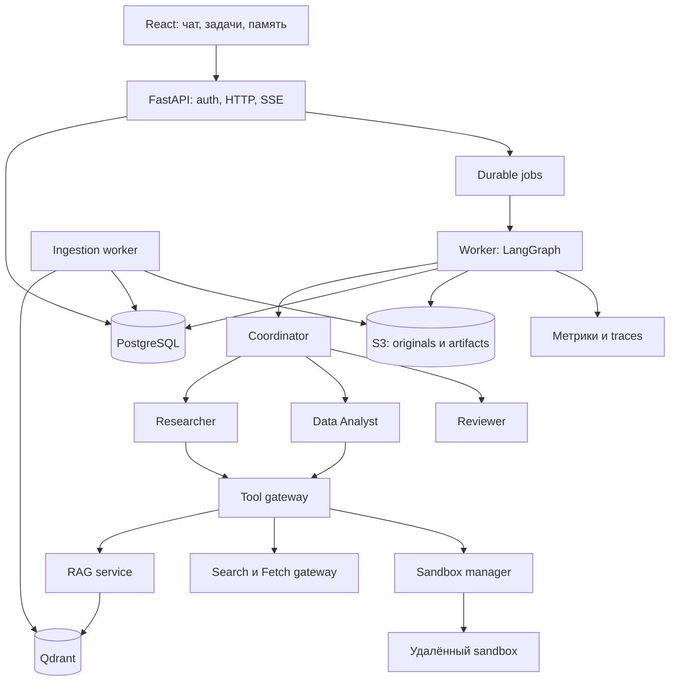
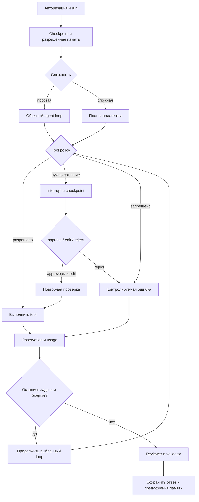

# Архитектура

## Назначение

Аналитический помощник команды: изучает внутренние документы, проверяет актуальные сведения в интернете, обрабатывает CSV в sandbox и выпускает отчёт с доказательствами. Пример: «По условиям поставки и заказам рассчитай задержки, проверь сведения о перевозчиках и подготовь рекомендации». Это выбранный референсный кейс, поскольку конкретная предметная область не задана.

Система включает чат, документы, историю, план, панель памяти, подтверждения и скачивание артефактов. Роли: viewer — анализ разрешённых данных; editor — также загрузка и подготовка внешних изменений; approver — подтверждение изменений своего проекта; admin — настройки и доступ. Полномочия задаёт сервер, а не текст запроса.

## Компоненты

| Часть | Выбор и назначение |
|---|---|
| Backend | Python, FastAPI, Pydantic: API и проверка контрактов |
| Runtime | LangGraph StateGraph: маршруты, checkpoints, interrupt/resume |
| Короткие задачи | LangChain create_agent: обычный model/tool loop |
| Сложный анализ | Deep Agents внутри роли Analyst: файлы, offloading, sandbox backend |
| Память | PostgreSQL, AsyncPostgresSaver, MemoryStoreAdapter |
| Поиск | Qdrant: dense и sparse vectors, ACL filters, reranking |
| Задания | PostgreSQL jobs с lease и SKIP LOCKED; отдельный worker |
| Файлы | S3-совместимое хранилище, подписанные короткоживущие ссылки |
| Sandbox | E2B через adapter; заменяемый провайдер |
| Интернет | SearchProvider adapter (первый кандидат Tavily) и FetchGateway |
| UI | React/TypeScript, SSE, approve/edit/reject, просмотр памяти |
| Наблюдаемость | OpenTelemetry/Prometheus; Langfuse как дополнительный trace backend |

Это один модульный backend с несколькими процессами, без обязательных микросервисов и Redis. Версии SDK и модели фиксируются после compatibility spike и smoke-тестов. Примеры импортов из презентации не считаются проверенным lock-файлом.

## Агенты и делегирование

| Роль | Вход → выход | Инструменты | Ограничения |
|---|---|---|---|
| Coordinator | Цель → план, подзадачи, итог | read_memory, propose_memory, task, todo | Нет shell и произвольного SQL |
| Researcher | Вопрос → findings и source_ids | rag_search, web_search, web_fetch | Только чтение |
| Data Analyst | Задание и input_refs → расчёты, artifact_ids | run_python, sandbox files/execute | Нет сети и секретов приложения |
| Reviewer | Черновик и evidence → accept/revise | read_source, read_artifact | Не подтверждает действия за человека |

Простой вопрос выполняет один агент. Сложная задача допускает максимум три подзадачи, две одновременно, глубину делегирования 1 и один цикл исправлений после review. Child получает только необходимые excerpts, ссылки на файлы и ограниченный набор tools. Возвращает findings, source_ids, artifact_ids, limitations, usage. Все попытки, включая summarization и review, входят в общий бюджет root run.

Deep Agents используется как ограниченный подграф Analyst, а не второй бесконтрольный supervisor. Его встроенные файловые middleware не добавляются повторно. TodoList включается явно в complex-профиле. Skills — проверенные версионированные инструкции из репозитория приложения; загруженный пользователем файл не может установить skill.

## Граф

У simple-ветки observation возвращается её модели; у complex-ветки — планировщику. Один ToolGateway обслуживает обе. Runtime state не заменяет таблицы заданий и журнал внешних эффектов.

Статусы run: queued → running → waiting_approval → queued → running → completed/partial/failed/cancelled. Отмена допустима из любого нетерминального состояния. Недостаток бюджета даёт partial при наличии полезного результата, иначе failed. Отказ от одного действия позволяет завершить анализ без него. completed выставляется после сохранения ответа и артефактов.

На thread разрешён один активный run. Новый запрос при занятости получает 409. Worker использует lease и fencing token; старый worker после потери lease не может записывать результат. Узел с interrupt не выполняет необратимых действий до подтверждения.

## Модели, prompts, structured output

Static-профиль использует одну модель. Dynamic-профиль выбирает fast model для маршрутизации и извлечения, reasoning model для сложного плана и кода. Решение учитывает тип задачи, context size, capabilities и бюджет, а не только число сообщений. Model registry хранит model_id, provider, context/output limits, tool/JSON support, разрешённые классы данных и датированные тарифы. Локальные модели подключаются тем же adapter после контрактных тестов.

Fallback разрешён только между совместимыми моделями с подходящей политикой обработки данных. Retry не повторяет ошибки авторизации и валидации. Максимум две повторные попытки с jitter/backoff; все попытки учитываются. Резерв бюджета производится до вызова.

Prompt состоит из инструкции роли, цели, разрешённых tools, релевантных предпочтений и evidence. Документы, web, память и tool results маркируются как данные и не могут назначать права. Версии prompts фиксируются в run. Сырые внутренние рассуждения модели не являются журналом прогресса.

Ответ: answer, status, citations, artifacts, limitations. Provider-native JSON применяется при поддержке, иначе ToolStrategy с Pydantic. Одна попытка исправления схемы входит в общий бюджет. Финальная проверка также подтверждает source_id, ACL и наличие файлов: валидный JSON не доказывает истинность ответа.

## Middleware

Базовые механизмы перечислены в [официальном каталоге](https://docs.langchain.com/oss/python/langchain/middleware/built-in). Следующая последовательность — политика проекта.

| Hook | Ответственность |
|---|---|
| before_agent | Run context, доступ, lease, дедлайн, загрузка памяти |
| before_model | Context editing, summary, trim полных turns, проверка окна |
| wrap_model_call | Динамическая модель/tools/prompt, reserve usage, retry/fallback, tracing |
| after_model | Usage, проверка схемы и tool args, proposal действия |
| wrap_tool_call | Повторная авторизация, лимит, HITL, идемпотентность, timeout, ошибка/offload |
| after_agent | Результат, memory candidates, аудит и завершение задания |

before-хуки идут в прямом порядке списка, after-хуки в обратном, первый wrap оборачивает остальные. Порядок проверяется integration-тестом. Gateway повторяет критичные проверки независимо от middleware. Счётчики в state отображают durable ledger, а не служат единственным источником лимитов.

Декораторы применяются для единичного dynamic_prompt/метрики. Конфигурируемые политики оформляются классами с async hooks. jump_to=end завершает запрещённый/исчерпанный запуск; model допускает ограниченное исправление; tools требует валидного разрешённого вызова. Слово BLOCKED в тексте не является проверкой безопасности.

LLMToolSelector сужает уже авторизованный каталог до трёх релевантных tools, но не выдаёт права. LLMToolEmulator работает только в simulation-профиле, с явной меткой synthetic и запретом внешних записей; CI использует детерминированные fake adapters. Monitor фиксирует tool name, latency, outcome и usage без секретов.

## Ключевые решения

PostgreSQL — источник истины, Qdrant — восстанавливаемый индекс. Sandbox files не заменяют память и долговечные артефакты. LocalShellBackend и FilesystemBackend не используются как защита недоверенного кода. Все роли обращаются к tools через gateway. Пользователь видит план, источники, ошибки и стоимость, но не получает обещание безошибочности модели.
